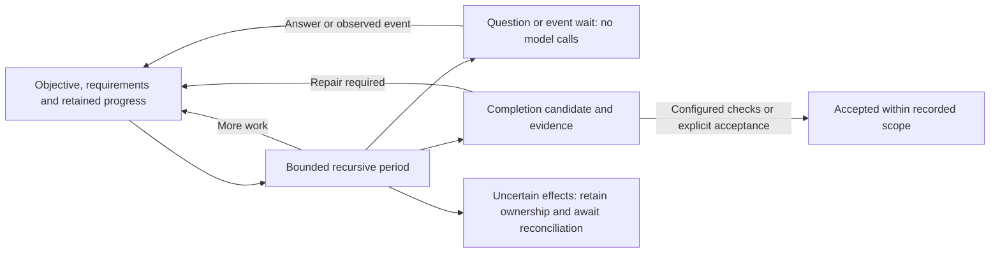

# Durable goals — unreleased 0.3 development

> **Version scope:** This public copy preserves the guide’s release and development labels. Features marked unreleased are not available in an older installed binary. Private-source links require repository access.

This interface is under qualification. Public v0.2.1 does not include it.
See [the release plan (private source)](https://github.com/noxstellar/spine/blob/6ff0ba84d7d442abd3b96e65cbe0add115f11b02/rust/NEXT_RELEASE_PLAN.md) for remaining gates and the
[configuration reference](CONFIGURATION.md) for all defaults and examples.

A goal records its objective and acceptance requirements **before any model
work**, plus user corrections, retained reports and an optional lifetime budget.
No overall turn, period or elapsed-calendar-time cap is imposed by default.
Each work period uses the ordinary recursive execution core. Subsequent periods
replan from retained public state; they do not replay an interrupted task stack.
Ordinary `spine run` incurs no goal-store or mandatory planner calls.

The model finishes a period with typed progress: `continue`, `needs_input`,
`wait` or `complete`. The host checks field combinations and preserves remaining
obligations. A completion declaration creates a candidate; default acceptance
requires configured checks or an explicit user decision. Invalid progress receives
repair feedback within the period's existing limits, without an extra allowance.



## Start and control a goal

With a development build and configured provider, create a specification outside
the model workspace:

```json
{
  "objective": "Prepare the supplier comparison and ask me for missing criteria.",
  "acceptance": [
    "Cite supplied evidence for each price and service claim.",
    "List unresolved questions before recommending a supplier."
  ]
}
```

```sh
spine goal create /absolute/workspace /outside/workspace/goal.json
spine goal run GOAL_ID
spine goal show GOAL_ID
```

Creation returns an ID and revision. `run` supervises successive periods until
accepted or explicitly cancelled. Questions, waits, blockers and attention states
remain pending; it reports the reason and waits without model calls. Answer or
amend the goal to resolve missing information. A recorded timer deadline wakes
automatically; an external event requires explicit input.

Use `SPINE_GOAL_DRIVE=until_wait` to return at a wait/attention boundary for an
external scheduler, or `run GOAL_ID --once` for at most one period. Final JSON
includes the goal and its status. `started` identifies admission of the last
requested period; configuration rejection does not spend the goal allowance.

Control operations require the current revision from `show`; stale updates fail:

```sh
spine goal amend GOAL_ID REVISION 'Prioritize total annual cost.'
spine goal answer GOAL_ID REVISION QUESTION_ID 'The budget is 25000 EUR.'
spine goal wake GOAL_ID REVISION EVENT_ID 'The supplier response is available.'
spine goal accept GOAL_ID REVISION CANDIDATE_ID
spine goal cancel GOAL_ID REVISION 'The request has been withdrawn.'
```

Question, event and acceptance-candidate IDs are distinct. `amend` records a
correction, including during active execution. The host queues it for a safe
boundary; a late correction remains available to the next period. Results based
on an earlier revision cannot complete a revised goal. An explicit amendment
reopens an accepted/model-completed goal under its existing limits.

In CLI supervision, stdin text answers the current pending question, or records
a correction if none is pending. `/accept CANDIDATE_ID` explicitly accepts a
candidate; ordinary text such as “yes” is an answer, not acceptance. Text at a
terminal state is rejected: reopening requires the explicit amendment command.

Storage/control commands make no provider calls. Keep the supervising process
running, or have an application restart it for the stored goal. Spine does not
install an OS daemon. A configuration flag cannot guarantee arbitrary task
success, machine uptime or provider availability; unavailable dependencies remain
visible as unfinished work. Calendar waiting does not spend active-work time.

## Limits and accounting

The optional `mode` is `auto` (default), `direct` or `recursive`. `allowed_tools`
restricts exact tool names and is inherited by descendants. Model/provider
configuration follows ordinary runs; the stored goal controls its own limits.

The default lifetime is `null`: **no overall maximum turn/period count**. Bounded
periods limit each execution slice, not the total number of slices. The default
period is:

```json
{
  "requests": 16,
  "max_request_bytes": 1048576,
  "total_request_bytes": 8388608,
  "output_tokens": 65536,
  "steps": 32,
  "tasks": 8,
  "tools": 32,
  "depth": 4,
  "active_seconds": 300
}
```

Supply a complete `period` object to change it. DIRECT fixes one task/depth zero.
A finite overall cap is optional; this example deliberately enables one:

```json
{
  "objective": "Reconcile the weekly operating reports.",
  "lifetime": {
    "requests": 320,
    "request_bytes": 167772160,
    "output_tokens": 1310720,
    "steps": 640,
    "tasks": 160,
    "tools": 640,
    "active_seconds": 6000,
    "periods": 20
  }
}
```

Omit `lifetime` to leave it unlimited. Zero is not an unlimited marker. Explicit
limits are retained and cannot reset on restart, reconnect or amendment. Reaching
an explicit lifetime cap keeps the goal unfinished and waiting for direction.

Before dispatch, the host reserves a period within any remaining finite allowance.
It settles consumed counters only against an owned closed report and durable
request journal. Unused capacity is released; spent requests, rejected decisions
and uncertain effects are not refunded. Each started period charges its full
active-time slice conservatively. This is an accounting policy, not CPU or model
elapsed time. Output reservations are not actual token counts or currency costs.

The older `SPINE_VERIFICATION_POLICY` and `SPINE_PUBLIC_CHECK_SET` Task policies
are rejected before goal admission or prompt correction: they lack a nonfinal
pause contract. Goal completion predicates below use a separate goal contract;
no verification policy is silently bypassed.

## Completion acceptance

New goals default to `{"mode":"require_acceptance","checks":[]}`. A valid
completion without checks creates a `needs_input` candidate. Review the retained
report and use `goal accept` with its exact ID/current revision. Confirmation
rechecks the report, contract and listed artifact snapshots. It does not verify
unlisted workspace files independently.

To accept a machine-checkable result automatically, include a policy such as:

```json
{
  "objective": "Count the supplied records and write result.json.",
  "completion": {
    "mode": "require_acceptance",
    "checks": [{
      "id": "expected-count",
      "path": "result.json",
      "expected": {"kind": "json_equals", "value": {"count": 3}}
    }]
  }
}
```

`sha256` is also supported, using a lowercase 64-digit hex value. These are exact
file predicates, not semantic judges. Expected values stay outside model context;
failed checks return bounded repair feedback. Limits are 64 checks, 2 MiB per
file and 32 MiB total artifact bytes. Paths must be regular workspace files,
without traversal, symlinks or hardlinks. Keep specifications containing private
expectations outside the model's workspace.

Corrections, answers and human wake messages can change requirements. They prevent
old predicates from automatically accepting revised work; passing checks then
require explicit confirmation. Mechanical scheduled wakes do not change this
scope. The initial ACP prompt for a ready attached goal is also a user correction;
it therefore requires confirmation after passing checks. CLI supervision does
not insert an initial correction. Immutable acceptance receipts retain the candidate identity. Stale
confirmations and changed reports/artifacts are rejected.

Amendments do not rewrite configured predicates or budgets. If changed requirements
conflict with an old exact predicate, explicit acceptance cannot override that
failure. Create a goal with the revised contract and explicitly cancel the old
one; Spine does not infer a new machine-checkable predicate from free text.

Explicit `{"mode":"model_declared"}` preserves the legacy declaration-only
behavior, terminating at `model_completed`. Legacy records keep their policy and
finite limits. Model evidence references, summaries and diagnoses remain labeled
declarations, not independent proof of every natural-language requirement.

## ACP integration

Initialization advertises `com.spine.goals`. `_spine/goal` is a Spine extension
to ACP v1, not a standard ACP goal protocol. Requests use `sessionId` and a strict
`operation` object:

```json
{
  "sessionId": "SESSION_ID",
  "operation": {
    "op": "create",
    "goal": {
      "cwd": "/absolute/workspace",
      "objective": "Prepare the supplier comparison."
    }
  }
}
```

The returned goal matches CLI `show`. Attach with
`{"op":"attach","goalId":"GOAL_ID"}`. A normal session prompt then supervises
successive periods and waits, keeping its request pending. A prompt for a ready
goal is retained as a correction; for a waiting goal it starts supervision without
inventing an answer. Typed operations can resolve the dependency while that prompt
is pending. Load/attach start no work. `SPINE_GOAL_DRIVE=until_wait` enables the
external-scheduler behavior.

| Operation | Fields |
| --- | --- |
| `show`, `attach` | `goalId` |
| `detach` | None; idle session only |
| `amend` | `goalId`, `expectedRevision`, `message` |
| `answer` | `goalId`, `expectedRevision`, `questionId`, `answer` |
| `accept` | `goalId`, `expectedRevision`, `candidateId` |
| `wake` | `goalId`, `expectedRevision`, `eventId`, `message` |
| `cancel` | `goalId`, `expectedRevision`, `reason` |

An explicit matching event wakes a wait. `eventId: null` requires a recorded
scheduled time that has arrived according to the host clock. Client permissions,
tools, session cancellation and `_spine/steer` remain in use. Attached-goal
steering is persisted before acknowledgment. CLI and ACP share storage, revisions
and accounting; an OS lock prevents concurrent supervisors for one goal.

`session/cancel` ends supervision or the active period without implicitly
cancelling the stored goal. Use goal `cancel` for that. An idle goal can be watched
by a later prompt, with no model call until its dependency resolves. Work periods
and goal-input updates have separate bounded journals, so a long prompt does not
accumulate an unlimited in-memory transcript or inherit an ordinary turn's total
steering-message cap. The per-message input limit remains.

Generic editor clients need UI support for these extensions; use the CLI for
goal control until then. See [editors](EDITORS.md) and [ACP](ACP.md).

## Recovery and retained context

Records live outside the workspace under `$XDG_STATE_HOME/spine/goals`, normally
`~/.local/state/spine/goals`. Reports retain paths, hashes and accounting. Exact
older periods and user input remain in immutable hash-bound archives; only recent
records and bounded indexes remain in the active view. The hot input window holds
at most eight entries and 128 KiB serialized; unusually escaped input can use
fewer entries. Current work receives the
original requirements, recent input, history locators and latest progress with
remaining obligations. An archive locator is not a semantic summary of old input.

The scoped `goal_history` tool retrieves exact settled progress, user input and
safe work-slice checkpoints in UTF-8 pages:

```json
{"index": 0, "record": "progress", "max_bytes": 4096}
```

```json
{"index": 0, "record": "user_input", "input_kind": "correction", "max_bytes": 4096}
```

```json
{"index": 0, "record": "execution", "max_bytes": 4096}
```

`progress` is the default. For user input, `index` is the zero-based global
input index, or the ordinal within the optional `input_kind`. Execution records
contain observed public work and explicitly unexecuted pending actions; a
`prior_continuation` locator preserves the chain to earlier slices. Follow
`next_offset` to read later pages. The page request defaults to 4,096 bytes and
permits at most 8,192, within the 16 KiB encoded output bound.

It costs one ordinary tool unit, obeys ancestor restrictions and must appear in
an explicit `allowed_tools` list. Reads verify report identity, hashes and settled
accounting. Pages are capped at 16 KiB including JSON escaping. Arbitrary paths,
other goals and private reports are inaccessible. External MCP names are
namespaced and cannot impersonate the internal tool.

New acceptance-based goals may continue after a typed limit reached between
completed steps, or an accounted pre-dispatch request-limit refusal that can fit
a fresh period. The host first verifies closed resources, exact checkpoint and
accounting, then replans from the retained observations under the same goal
account. It never resumes a failed task stack with reset limits. Required history
retrieval must remain permitted and affordable. Repeated identical public work
asks for direction instead of spinning.

Generic provider errors, malformed returns and unmarked tool/task/depth failures
are not silently classified as safe work slices. They remain explicit blockers;
in-flight uncertain effects retain their ownership fence. Explicit legacy
`model_declared` execution preserves its original limit behavior.

A missing report, uncertain action, damaged accounting or failed cleanup keeps
the active period and reservation fenced. Restart or elapsed time does not grant
retry permission. There is no recovery command that simply clears that fence;
reconciliation requires evidence of what happened. The supervisor reports the
attention state and awaits resolution instead of marking success.

After three settled periods with identical declared progress, no tool/child work
and unchanged input, the host asks what should change. It records `blocked` while
supervision remains pending; an explicit amendment can continue under the same
limits. This detects exact repetition without observed action. Changed wording
or tool activity does not itself prove progress. Repeated rejected completion
without action is also subject to this safeguard.

For optional graph/timeline diagnostics, use `SPINE_TRACE=1 spine goal run ID`
and `spine trace REPORT.trace.jsonl --html review.html`. Each period gets its own
trace. Details and coverage limits are in [tracing](TRACING.md). Scripted lifecycle
controls do not prove week-scale model competence or superiority over other agents.
